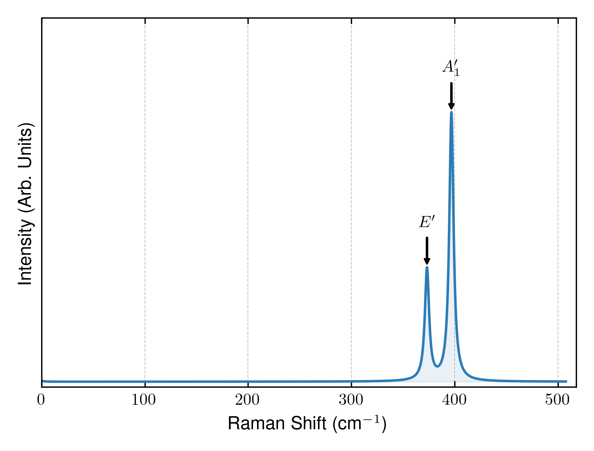

# SpectroPy

SpectroPy is a Python toolkit for predicting Raman spectra from first-principles
calculations with the Placzek approximation. It prepares finite-displacement
structures, uses Phonopy symmetry information to reduce and reconstruct the
required dielectric-tensor derivatives, and combines those derivatives with
phonon eigenvectors to produce Raman tensors, intensities, and broadened plots.




## Features

- Generates finite-displacement `POSCAR` files from a relaxed `CONTCAR`.
- Optionally uses Phonopy to generate a symmetry-reduced displacement set.
- Prepares one calculation directory per displacement without prescribing a
  VASP execution method.
- Collects VASP `vasprun.xml` outputs and calculates complex,
  frequency-dependent dielectric-tensor derivatives.
- Reconstructs unmeasured directions and symmetry-equivalent atoms from
  phonon symmetry operations.
- Builds per-mode Raman tensors and intensities for specified and
  orientation-averaged experimental geometries.
- Produces Lorentzian- or Gaussian-broadened Raman plots.
- Checks mode symmetry consistency and exports polarization-angle scans.
- Generates VMD or VESTA phonon-mode visualizations.

## Installation

Install from a checkout:

```bash
python -m pip install .
```

Core dependencies are Python 3.9+, NumPy, and PyYAML. To use Phonopy-based
minimal displacements and plotting, install the optional dependencies:

```bash
python -m pip install '.[all]'
```

VASP is an external, proprietary prerequisite. You also need a Phonopy
calculation containing Gamma-point modes (`q-position: [0, 0, 0]`).

### `input` file

Each calculation directory may contain an `input` file. Its first three lines
retain the established MoS₂-style geometry format (incident polarization,
scattered polarization, then surface normal). Add `laser_energies:` to request
one or more dielectric-derivative energies. If the line is omitted, SpectroPy
uses `0.00 eV`, the static-limit calculation.

```text
1.0 0.0 0.0
1.0 0.0 0.0
z
laser_energies: 0.00 1.96 2.33
cutoff: 1.0
broadening_fwhm: 1.0
broadening_type: lorentzian
```

`broadening_fwhm` is in cm⁻¹ and defaults to `1.0`; `broadening_type`
defaults to `lorentzian` and may instead be `gaussian`.

`cutoff` is optional and expressed in cm⁻¹. When it is set, modes at or above
the cutoff receive the 298 K Bose/`1/ω` cross-section factor. When omitted,
SpectroPy writes raw reduced Raman intensities, matching the legacy Fortran
default. `frequency_cutoff` is accepted as an equivalent spelling.

## Command-line interface

The installed `spectropy` command runs existing workflow stages in the current
directory. Use `--workdir` (or `-C`) to run a stage elsewhere.

```bash
spectropy --help
spectropy displacements --help
spectropy displacements --mode minimal --workdir /path/to/calculation
```

| Command | Purpose |
| --- | --- |
| `spectropy displacements --mode full` | Create the full `+/-x`, `+/-y`, `+/-z` set for every atom and VASP-ready directories. |
| `spectropy displacements --mode atoms` | Create the full `+/-x`, `+/-y`, `+/-z` set for symmetry-inequivalent atoms only. |
| `spectropy displacements --mode minimal` | Create Phonopy's minimum symmetry-reduced displacement set. |
| `spectropy displacements --mode fractional` | Use a local implementation of Phonopy's fractional direction selection and save its reconstruction basis; derivatives are converted to Cartesian before mode contraction. |
| `spectropy symmetry` | Write the symmetry-operation matrices relating equivalent atoms. |
| `spectropy derivatives` | Evaluate dielectric derivatives at every laser energy in `input`. |
| `spectropy spectrum` | Combine `band.yaml` and derivatives into Raman tensors and intensities. |
| `spectropy plot` | Interactively broaden and plot generated Raman intensities. |
| `spectropy check` | Export absolute, squared, and relative symmetry-projection residuals for all modes. |
| `spectropy angular --modes 110` | Export parallel and crossed polarization-angle scans for selected modes. |

The CLI uses the same input/output conventions as the Python API. The optional
phonon-mode visualization helper remains available directly:

```bash
python src/visualize_modes.py
```

## Raman workflow

The following workflow starts from a relaxed crystal structure. The
[`examples/MoS2_Tutorial`](examples/MoS2_Tutorial/README.md) directory provides an example.

### 1. Prepare a calculation directory

Create a directory containing:

1. A relaxed VASP structure named `CONTCAR`.
2. Phonopy's Gamma-point `band.yaml` and, optionally, `irreps.yaml`.
3. Phonopy's YAML `symmetry` output when using `atoms` or `minimal`
   displacements and their derivative reconstruction.
4. The DFT inputs to reuse for every displacement: normally `INCAR`,
   `KPOINTS`, and `POTCAR` for VASP.

### 2. Generate displacement structures

The `input` file also selects the derivative scheme:

```text
difference_scheme: central
dielectric_source: outcar
```

For forward differences, use `difference_scheme: forward` before generating
displacements. SpectroPy also creates `displacements/ra_pos_equilibrium/POSCAR`, containing
the undisplaced reference. The workflow runs it alongside the `ra_pos_*`
displacement directories with the same optical inputs. Derivative processing
automatically reads `displacements/ra_pos_equilibrium/OUTCAR` (or `vasprun.xml` when selected); no equilibrium path
setting is needed. The reference is not a zero-length displacement in
`displacements.dat`. Central differences remain the default and do not
generate this extra directory. `--difference` overrides the input scheme;
`--equilibrium-file` (`--equilibrium-vasprun` is a compatibility alias) remains an optional override for existing external
reference calculations.

`dielectric_source: outcar` is the default for both displaced and equilibrium
optics. It reads the six-decimal density-density dielectric tables, requires
the requested energy to exist exactly on the printed grid, and never silently
falls back to XML. To use the finer XML energy grid with its lower printed
precision and legacy nearest-energy selection, set
`dielectric_source: vasprun.xml`. Derivative exports retain full Python
floating-point precision; this does not add digits to the original VASP output.

```bash
# Full finite-difference set: every atom in +/- Cartesian directions.
spectropy displacements --mode full

# Full +/- Cartesian set, but only one atom from each symmetry-equivalent set.
# Requires Phonopy's `symmetry` file.
spectropy displacements --mode atoms

# Symmetry-reduced set (requires Phonopy).
spectropy displacements --mode minimal
```

Every mode writes `ref_poscar.vasp`, `displacements.dat`, and the
pipeline-compatible `atomic_displacement`, then creates `displacements/pos_atom*` and
`displacements/ra_pos_atom*/POSCAR` outputs. SpectroPy does not link or create DFT input
files; add the inputs required by your own DFT code to each directory. The
`atoms` mode requires Phonopy's YAML `symmetry` file and reconstructs the
remaining atoms during the derivative stage.

Fractional mode also writes `fractional_basis.json`. It stores each
representative atom's three-vector reconstruction basis, its inverse, and
the symmetry transformations that supply its directional responses. The
derivative stage reuses this basis for both tensor parts and every laser
energy, without repeating direction selection. The saved file is checked
against the displacement records, lattice, and site rotations; a stale file
is rejected. Historical datasets without this file remain supported: their
bases are prepared once in memory when the derivative command starts.

### 3. Run DFT calculations

Run your DFT code in every `displacements/ra_pos_atom*` directory. SpectroPy does not
choose your functional, k-point mesh, dielectric settings, executable, or job
submission strategy. For the VASP frequency-dependent workflow, each completed
directory must contain `vasprun.xml` with dielectric-function data at the
requested laser energy.

### 4. Calculate dielectric derivatives

```bash
spectropy derivatives
```

This command evaluates every `laser_energies` value in `input`. It copies
`displacements/ra_pos_atom*/vasprun.xml` into `displacements/vasprun/`, then writes:

- `dielectric_tensor_<frequency>`: dielectric tensor for every displacement.
- `epsilon_derivative_<frequency>`: complex dielectric-tensor derivatives
  for all atoms, including symmetry-reconstructed data where applicable.

When `laser_energies` is absent, SpectroPy evaluates the default `0.00 eV`
case. This replaces the separate static-derivative workflow.

For debugging, inspect the operations used to map equivalent atoms with:

```bash
spectropy symmetry
```

This writes `symmetry_operation_matrices`.

### 5. Calculate the Raman spectrum

```bash
spectropy spectrum
```

This command reads `band.yaml`, `irreps.yaml` when present, and the derivative
file for every `laser_energies` value in `input`. It prompts for the
experimental geometry unless `input` is provided, then writes:

- `Raman_tensor`: complex Raman tensor for each vibrational mode.
- `Raman_intensity_complex_<energy>eV`: frequency and intensity for the
  requested polarization geometry.
- `Raman_intensity_polarization_averaged_<energy>eV`: orientation-averaged
  (powder) intensities.

To predefine the geometry and laser energies, create `input` as follows:

```text
1.0 0.0 0.0   ! incident-light polarization
0.0 1.0 0.0   ! scattered-light polarization
z             ! surface-normal direction
laser_energies: 0.00 1.96 2.33 ! eV; 0.00 is the static-limit calculation
broadening_fwhm: 1.0 ! cm-1
broadening_type: lorentzian
```

### 6. Broaden and plot results

```bash
spectropy plot
```

The plotter reads `broadening_fwhm` (default `1.0 cm⁻¹`) and
`broadening_type` (`lorentzian` by default, or `gaussian`) from `input`. It
scans the current directory tree for Raman intensity files and writes
publication-style PNG plots alongside them. It also writes unnormalized,
two-column numerical spectra named
`Raman_intensity_complex_broadening_<energy>eV`, matching the Raman-workflow
file convention. If LaTeX is installed it is used for rendering; otherwise
Matplotlib's standard fonts are used.

## Symmetry checks and polarization-angle scans

Run after dielectric derivatives are available. `check` reads `band.yaml`,
`symmetry`, `ref_poscar.vasp` (or `CONTCAR`), `input`, and
`epsilon_derivative_<energy>`; `irreps.yaml` supplies optional mode labels.
No DFT rerun or prior `spectropy spectrum` command is required.
`angular` only requires `band.yaml`, `input`, and the derivative files.

```bash
spectropy check
spectropy check --plot --style /path/to/raman.mplstyle
spectropy check --kind mode --plot --output mode_check
spectropy angular --modes 110 --plot
spectropy angular --modes 110 111 --energies 0.00 1.96 --angle-step 0.5
spectropy angular --modes 110 --plot --style /path/to/raman.mplstyle -C /path/to/raman
spectropy check --help
spectropy angular --help
```

`check` outputs go to `check/`, and `angular` outputs go to `angular/`
(`--output` changes either destination). The commands run independently:

- `symmetry_residuals_<energy>eV.csv`: all mode indices, frequencies, irreps,
  absolute and squared Frobenius residuals, relative residuals, both tensor
  norms, and the regularizer.
- `angular_intensity_mode<mode>_<energy>eV.csv`: angle in degrees and the
  calculated parallel and crossed intensities. Mode numbers are
  1-based. Only `spectropy angular` accepts `--modes`.
- `README.txt`: conventions and interpretation. `--plot` also produces PNG
  figures and requires the optional plotting dependencies.

The projector averages the complete atomic derivative field over all supplied
space-group operations, including atom permutations and Cartesian rotation
of all three tensor indices. It then contracts the projected derivatives with
the same mass-weighted phonon eigenvectors. The relative residual is
`norm(R - R_projected) / (max(norm(R), norm(R_projected)) + epsilon)`, with
`epsilon = 1e-12 * max(1, largest mode norm)` per energy; use
`--epsilon-fraction` to change that fraction. Complex tensor elements are retained.

This measures symmetry consistency, not total numerical error. Reconstruction
can already enforce some constraints. Compatibility of structural symmetry
with the electronic/magnetic state is assumed, and projecting atomic
derivatives does not itself correct phonon eigenvectors.

`check --kind mode` is a separate direct check of
`S_g R_k S_g^T = sum_p Gamma_pk(g) R_p`, without any atomic projection.
It requires `irreps.yaml` for the partner-mode groups and constructs
`Gamma_pk = <e_p|T(g)e_k>` from the `band.yaml` mass-weighted eigenvectors,
using the atom permutations and Cartesian rotations in `symmetry`.
For this diagnostic, phonon atoms are matched to derivative atoms by species
and periodic positions, allowing a unique common origin shift (1e-3 Angstrom
matching tolerance). The mapping and origin shift are recorded; ambiguous
matches or different Cartesian lattice frames are rejected. This alignment
does not alter any files or other analysis commands.
Subspace closure is checked (default tolerance `1e-5`, configurable with
`--subspace-tolerance`); supplied irrep characters are also checked.
Groups failing closure or character validation are flagged with unavailable
(`NaN`) tensor residuals and omitted from plots, rather than silently treating
degenerate partners as individually invariant. Invalid overall eigenvector
normalization or inconsistent atom counts are rejected.

Outputs are `mode_covariance_residuals_<energy>eV.csv` and
`multiplet_covariance_residuals_<energy>eV.csv`, plus matching PNGs with
`--plot`. The absolute residual is the RMS over operations of the constraint
error's Frobenius norm. Plots show only absolute residuals, with dot area
increasing with Raman intensity, fully opaque points, and short horizontal visibility ticks.
The larger RMS constraint-side norm, `max(a_k, b_k)`, remains in numerical
exports but is not plotted.
The direct mode check has no relative residual or regularizer.
Multiplet squared norms sum over all partners and are basis-independent;
individual partner residuals depend on the phonon eigenvector basis.
This checks covariance, not total accuracy, and does not change any tensors.

The workspace comparison script `raman_workflow/post/analysis/plot_mode_covariance_residuals.py`
runs this check for the five BN 9x9 fractional displacement sizes and three
laser energies, writing new tables and comparison grids under
`post/graphs/mode_covariance/`. It reuses representation matrices only after
verifying identical phonon, irrep, symmetry, and reference-structure files.
Existing spectrum/angular commands do not perform this atom alignment;
results from mismatched atom ordering require separate review.

For a `z` surface normal, parallel scans use
`e_incident = e_scattered = (cos(theta), sin(theta), 0)`; crossed scans use
`e_scattered = (-sin(theta), cos(theta), 0)`. The normal defaults to `input`
or `z` and can be set with `--surface-normal`. Scans retain the existing
cutoff/298 K frequency weighting, with no per-curve normalization or symmetry
filtering. For an unresolved degenerate multiplet, sum the exported mode
intensities, not the tensors or amplitudes.

The Python API is available from `spectropy_checks`: `symmetry_operations`,
`project_derivatives`, `mode_tensors`, `projection_residuals`,
`angular_intensities`, `run_check`, and `run_angular`. Derivatives use shape
`(natoms, displacement_axis, dielectric_row, dielectric_column)`;
mode tensors use `(nmodes, 3, 3)`. `angular_intensities` returns
`(nmodes, nangles)` reduced intensities before frequency weighting.

## Phonon-mode visualization

`visualize_modes.py` generates VMD, VESTA, or both kinds of visualization
files from the phonon modes. For VESTA, first open `CONTCAR` in VESTA and save
a project file such as `template.vesta` in the calculation directory.

```bash
python visualize_modes.py
```

The script prompts for arrow scaling, output format, and—when needed—the VESTA
template. It creates `VESTA_MODES` and/or `VMD_MODES`. To load a VMD mode:

```tcl
source VMD_MODES/mode_001.vmd
```

## Future work

The current `epsilon_derivative_<energy>` files apply the
`V_prim / (4*pi)` dielectric-to-polarizability conversion to each atomic
derivative before writing it to disk, where it is rounded and later reread for
the mode contraction. This follows the legacy Liangbo file convention, but it
is not the preferred internal design. A future refactor should retain raw
dielectric derivatives at full precision through the phonon-mode contraction,
then apply `V_prim / (4*pi)` once to the resulting mode Raman tensor. The
on-disk format and compatibility plan must be updated deliberately when this
changes.

## Citation

If you use SpectroPy in your research, please cite:

> **Raman Digital Twin of Monolayer Janus Transition Metal Dichalcogenides**
> Johnathan Kowalski and Liangbo Liang
> *ACS Applied Materials & Interfaces* (2025), Article ASAP.
> DOI: [10.1021/acsami.5c20316](https://doi.org/10.1021/acsami.5c20316)

```bibtex
@article{SpectroPy_Janus2025,
  author = {Kowalski, Johnathan and Liang, Liangbo},
  title = {Raman Digital Twin of Monolayer Janus Transition Metal Dichalcogenides},
  journal = {ACS Applied Materials \& Interfaces},
  year = {2025},
  note = {Article ASAP},
  doi = {10.1021/acsami.5c20316},
  url = {https://doi.org/10.1021/acsami.5c20316}
}
```

## License

SpectroPy is released under the [MIT License](LICENSE).
