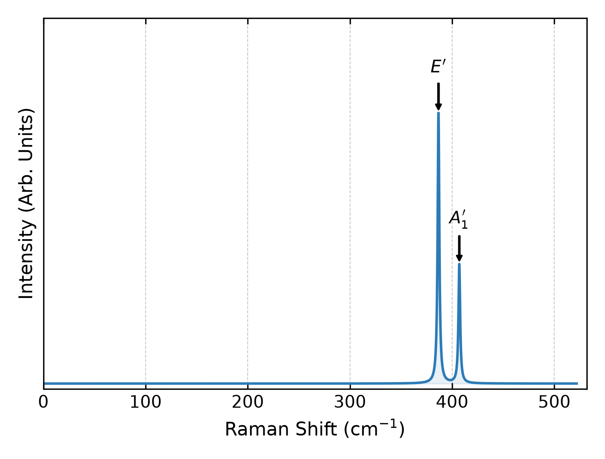

# SpectroPy

A Python toolkit for simulating Raman spectra from first-principles calculations. This package automates the setup of the finite displacement method for VASP, post-processes the results to calculate frequency-dependent Raman tensors, and generates plottable spectra for various experimental geometries.

## Key Features

- **Symmetry Reduction and Reconstruction**: Computes a symmetry-reduced set of atomic displacements and reconstructs the remaining dielectric derivatives at equivalent directions and atoms.
- **Symmetry Denoising**: Enforces atomic symmetry and reciprocity in the reconstructed derivatives.
- **Automated Setup**: Generates calculation directories and displaced `POSCAR` files.
- **Data Harvesting**: Automatically collects results from multiple `vasprun.xml` files.
- **Frequency-Dependent Tensors**: Calculates complex Raman tensors for user-specified laser energies.
- **Spectrum Simulation**: Produces plottable spectra for specific polarization geometries or summed polarization channels.
- **Mode Visualization**: Generates output files for visualizing phonon modes in **VMD** or **VESTA**.

## Requirements and Installation

Before you begin, ensure you have the following software installed and available:

| Requirement | Purpose |
| --- | --- |
| **VASP** | Run displaced-structure optical calculations. A licensed installation is required; it is not included. |
| **Python 3.9+**, NumPy, PyYAML | Run SpectroPy; Python dependencies are installed automatically. |
| **Phonopy** | Supply Gamma-point phonons with eigenvectors, and symmetry information for reduced displacements. |
| **Matplotlib** | Plot broadened spectra. |
| **VMD / VESTA** (optional) | Visualize phonon modes. |

Install from a checkout:

```bash
python -m pip install '.[all]'
spectropy --help
```


## Workflow & Usage Guide

Follow these steps to calculate a Raman spectrum from a relaxed crystal structure and Phonopy output:

### Step 1: Prepare Your Directory

Start with the following files from your completed relaxation and phonon-force
calculations. Keep the force outputs in their existing calculation directories.

| File | Contents |
| --- | --- |
| `CONTCAR` | Relaxed VASP structure. |
| `phonopy_disp.yaml` | Displacement records created by `phonopy -d` before the force calculations. |
| `hf_POSCAR-001/vasprun.xml`, `hf_POSCAR-002/vasprun.xml`, … | VASP force outputs for every displacement in `phonopy_disp.yaml`, in record order. Use your actual directory names. |
| `INCAR`, `KPOINTS`, `POTCAR` | VASP inputs to use for the finite displacement calculations. |

Create `input.yaml` in your Raman directory to keep the calculation settings
together; each stage reads this file:

```yaml
polarization:
  incident: [1, 0, 0]       # Incident light polarized along x
  scattered: [1, 0, 0]      # Analyze scattered light along x (ZXXZ geometry)
  surface_normal: z        # Sample surface normal along z
  mode: specific           # Use this incident/scattered polarization pair

spectrum:
  energies: [0.00, 1.96]    # Laser energies in eV; 0.00 selects static response
  temperature: 298         # Kelvin, for the Stokes Bose occupation factor

displacements:
  basis: cartesian         # Basis for candidate displacement directions
  amplitude: 0.01          # Physical displacement length in Angstrom
  difference: central      # Generate +/- pairs unless symmetry supplies a sign

symmetry:
  reduction: on            # Reduce both atoms and directions by symmetry
  denoise: true            # Enforce symmetry and dielectric reciprocity

broadening:
  hwhm: 1.0                # Peak half-width at half-maximum in cm^-1
  type: lorentzian         # Spectral line shape

output:
  per_atom:
    enabled: true          # Also save final atomic derivatives and dielectric matrices
    raw_directional_derivatives: true # Also save raw measured-direction derivatives
```

#### Export the files from an existing phonon calculation

Run these commands in your completed phonon-force calculation directory
(Phonopy 3.5 syntax):

```bash
phonon_dim="4 4 1"  # Use the same dimensions as when generating the force displacements

# Collect VASP forces -> FORCE_SETS (zero-padded displacement directories).
phonopy -f hf_POSCAR-*/vasprun.xml

# Generates file describing crystal symmetry of the reference cell
phonopy -c CONTCAR --symmetry > symmetry

# Gamma-point frequencies and eigenvectors -> band.yaml
phonopy -c CONTCAR --dim="$phonon_dim" \
  --band="0 0 0 0 0 0" --band-points=1 --eigvecs

# Optional Gamma-point mode labels for plotting purposes -> irreps.yaml
phonopy -c CONTCAR --dim="$phonon_dim" --irreps="0 0 0"
```

Place `band.yaml`, `symmetry`, and optional `irreps.yaml` beside `CONTCAR`
and `input.yaml` in your Raman directory. 

### Step 2: Generate Displacements
In the same directory as `CONTCAR`, `input.yaml`, and `symmetry`, run

```bash
spectropy displacements
```

The generated output files have this layout (`...` represents other displacements):

```text
calculation/
├── displacements.dat
└── displacements/
    ├── ra_pos_atom1a/
    │   ├── POSCAR
    │   ├── INCAR   -> ../../INCAR
    │   ├── KPOINTS -> ../../KPOINTS
    │   └── POTCAR  -> ../../POTCAR
    └── ...
```

| File | Format and contents |
| --- | --- |
| `displacements.dat` | Plain text: selection metadata, atom indices, and fractional displacement vectors. |
| `POSCAR` | VASP structure format: individual displaced structures. |
| `INCAR`, `KPOINTS`, `POTCAR` | Symlinks to your shared optical inputs, not copies. |

### Step 3: Run VASP

Run VASP in each `displacements/ra_pos_*` directory using your cluster's launcher.
Calculate the dielectric response without relaxing the displaced structures.

### Step 4: Calculate Raman Tensors

Once all VASP jobs are complete:

```bash
spectropy tensors
```

SpectroPy reads the dielectric responses, reconstructs and denoises the atomic
derivatives, and contracts them with the phonon eigenvectors. It generates the following
output files: 

| Output (`<E>` is the laser energy in eV) | Format and contents |
| --- | --- |
| `Raman_tensor_<E>eV` | Text: mode index, frequency, symmetry label, and complex Cartesian 3×3 Raman tensor for each mode. |
| `epsilon_derivative_<E>` | Text: final denoised Cartesian atomic derivatives, reconstructed for every atom and direction. |
| `raw_directional_derivative_<E>` | Text: raw real/imaginary 3×3 derivative matrices along measured directions, with displacement and sign metadata. |
| `dielectric_tensor_<E>` | Text: unprojected real/imaginary dielectric matrices sampled from each calculated signed displacement. |

### Step 5: Calculate the Final Spectrum
Using these output files and the input settings, Spectropy computes the Raman spectrum intensites for each mode and can plot them: 

```bash
spectropy spectrum
spectropy plot
```

| Output (`<E>` is the laser energy in eV) | Contents |
| --- | --- |
| `Raman_intensity_complex_<E>eV` | Frequencies, intensities, and available symmetry labels for the chosen polarization. |
| `Raman_intensity_complex_broadening_<E>eV` | Unnormalized, two-column broadened spectrum. |



For the full settings reference, reconstruction equations, and other options,
see [Advanced Usage](docs.md).

Try the [MoS2_vasp example](examples/MoS2_vasp/README.md) to analyze bundled
VASP outputs, generate your own calculations, or compare symmetry on and off.

## Additional Utilities

### Visualizing Phonon Modes

This script generates files to visualize the atomic motion of each phonon mode in either **VMD** or **VESTA**.

Use `CONTCAR` and a matching `band.yaml` containing Γ-point eigenvectors.

#### For VESTA (Recommended):

1. Open your `CONTCAR` file in **VESTA**.
2. Save the file as a VESTA project file (e.g., `template.vesta`) in your working directory.

#### Run the script:

```bash
python -m spectropy.visualization
```

#### Answer the prompts:

- **Arrow scaling factor:** A number to control the arrow length (e.g., `0.5`). A negative value can be used to reverse the arrow direction.
- **Select output format:** Type `e` for **VESTA**, `v` for **VMD**, or `b` for **Both**.
- **Enter template file:** (If you chose VESTA) Type the name of the file you saved above (e.g., `template.vesta`).
- **Visualize in a supercell?** Type `no` to use the original cell.

#### Output

The script will generate new folders (`VESTA_MODES` and/or `VMD_MODES`) containing the visualization files for each mode.

- **`.vesta` files:** Open these in **VESTA** to see the structure and arrows automatically.
- **`.vmd` files:** Open **VMD**, go to `Extensions > Tk Console`, and type:
  ```tcl
  source VMD_MODES/mode_001.vmd
  ```
  to load the arrows for mode 1.

## Citation

If you use **SpectroPy** in your research, please cite our paper:

> **Raman Digital Twin of Monolayer Janus Transition Metal Dichalcogenides**
>
> *Johnathan Kowalski and Liangbo Liang*
>
> *ACS Applied Materials & Interfaces*, **2026**, *18* (3), 5697–5707
>
> **DOI:** [10.1021/acsami.5c20316](https://doi.org/10.1021/acsami.5c20316)

### BibTeX

```bibtex
@article{SpectroPy_Janus2026,
  author = {Kowalski, Johnathan and Liang, Liangbo},
  title = {Raman Digital Twin of Monolayer Janus Transition Metal Dichalcogenides},
  journal = {ACS Applied Materials \& Interfaces},
  year = {2026},
  volume = {18},
  number = {3},
  pages = {5697--5707},
  doi = {10.1021/acsami.5c20316},
  url = {https://doi.org/10.1021/acsami.5c20316}
}
```

## License

SpectroPy is released under the [MIT License](LICENSE).

---

## Contact

If you have any questions, feedback, or run into any issues while using **SpectroPy** feel free to reach out to us:

- **GitHub Issues:** [Open an issue](../../issues) on this repository for bug reports, feature requests, or workflow questions.
- **Email:** Contact Dr. Liangbo Liang at [liangl1@ornl.gov](mailto:liangl1@ornl.gov) for any inquiries.
