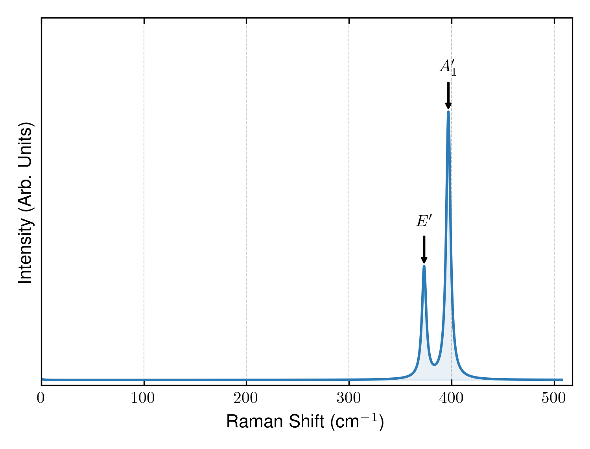

# SpectroPy

A Python toolkit for simulating Raman spectra from first-principles calculations. This package automates the setup of the finite displacement method for VASP, post-processes the results to calculate frequency-dependent Raman tensors, and generates plottable spectra for various experimental geometries.

## Key Features

- **Symmetry Reduction and Reconstruction**: Computes a symmetry-reduced set of atomic displacements and reconstructs the remaining dielectric derivatives at equivalent directions and atoms.
- **Symmetry Denoising**: Enforces atomic symmetry and reciprocity in the reconstructed derivatives.
- **Automated Setup**: Generates calculation directories and displaced `POSCAR` files.
- **Data Harvesting**: Automatically collects results from multiple `vasprun.xml` files.
- **Frequency-Dependent Tensors**: Calculates complex Raman tensors for user-specified laser energies.
- **Spectrum Simulation**: Produces plottable spectra for specific polarization geometries or summed polarization channels.
- **Mode Visualization**: Generates output files for visualizing phonon modes in **VMD** or **VESTA**.

## Requirements and Installation

Before you begin, ensure you have the following installed and available:

| Requirement | Purpose |
| --- | --- |
| **VASP** | Run displaced-structure optical calculations. A licensed installation is required; it is not included. |
| **Python 3.9+**, NumPy, PyYAML | Run SpectroPy; Python dependencies are installed automatically. |
| **Phonopy** | Supply Gamma-point phonons with eigenvectors, and symmetry information for reduced displacements. |
| **Matplotlib** | Plot broadened spectra. |
| **VMD / VESTA** (optional) | Visualize phonon modes. |

Install from a checkout:

```bash
python -m pip install .          # Core analysis
python -m pip install '.[all]'   # Also install plotting and Phonopy dependencies
spectropy --help
```

After updating an older checkout, reinstall to refresh the command entry point.
The library is now a `spectropy` package; `python -m spectropy` runs the same CLI.

The dielectric reader accepts complete `vasprun.xml` files with either nine
components or the standard six-component dielectric format. All printed entries
are preserved independently. If transpose components are missing, SpectroPy
warns and fills them by reciprocity (for example, $\epsilon_{yx}=\epsilon_{xy}$,
without complex conjugation). These entries are inferred, not measured; this
cannot recover a nonreciprocal response. Malformed XML, missing diagonal entries,
or missing entire off-diagonal pairs still fail. There is no OUTCAR fallback.

## Workflow & Usage Guide

Follow these steps to calculate a Raman spectrum from a relaxed crystal structure.

```text
Relaxed structure + Gamma-point phonons
                 |
        spectropy displacements
                 |
       Run VASP in each directory
                 |
         spectropy tensors
                 |
          spectropy spectrum
                 |
            spectropy plot
```

### Step 1: Prepare Your Directory

Create a new directory for your Raman calculation. Inside this directory, you will need:

| File | Contents |
| --- | --- |
| `CONTCAR` | Relaxed VASP structure. |
| `band.yaml` | Phonopy Gamma-point frequencies and mass-weighted eigenvectors. |
| `irreps.yaml` | Phonon symmetry labels for the plots. |
| `symmetry` | Phonopy YAML symmetry output. |
| `INCAR`, `KPOINTS`, `POTCAR` | VASP inputs to use for the finite displacement calculations. |
| `input.yaml` | Experimental geometry and SpectroPy settings, as below. |

Keep the calculation settings together in a file named `input.yaml`:

```yaml
polarization:
  incident: [1, 0, 0]
  scattered: [0, 1, 0]
  surface_normal: z
  mode: specific

spectrum:
  energies: [0.00, 1.96] # eV
  temperature: 0 # Kelvin; 0 gives a Stokes Bose factor of 1

displacements:
  basis: cartesian
  amplitude: 0.01 # Angstrom
  difference: central

symmetry:
  reduction: on
  denoise: true

broadening:
  hwhm: 1.0 # cm^-1
  type: lorentzian

output:
  per_atom:
    enabled: true
    raw_directional_derivatives: true
```

Here, the geometry selects xy polarization with surface normal z. The energies
select static and 1.96 eV responses; `reduction: on`, `cartesian`, and `0.01` select
symmetry-reduced directions with a 0.01 Å step. Central differences use ± pairs,
`denoise: true` enables denoising, and Lorentzian peaks have a 1 cm⁻¹ half-width.
The step is illustrative, not convergence-tested. Each stage reads `input.yaml`.
The `output` section enables final atomic derivatives, raw measured-direction
derivatives, and sampled dielectric matrices for inspection.

### Step 2: Generate Displacements

Choose one `reduction` entry in the `symmetry` section. For this workflow, keep
`on` enabled; switch to `off` when debugging or comparing unreduced results.

```yaml
symmetry:
  # reduction: off # Debugging: all atoms, three basis axes
  reduction: on    # Demonstration: symmetry-reduced atoms and directions
  denoise: true
```

Then generate the structures:

```bash
spectropy displacements
```

**Input**: `CONTCAR`, `input.yaml`, and `symmetry` for the reduced example above.

The main generated files have this layout (`...` represents other displacements):

```text
calculation/
├── displacements.dat
├── ref_poscar.vasp
└── displacements/
    ├── ra_pos_atom1a/
    │   ├── POSCAR
    │   ├── INCAR   -> ../../INCAR
    │   ├── KPOINTS -> ../../KPOINTS
    │   └── POTCAR  -> ../../POTCAR
    └── ...
```

| File | Format and contents |
| --- | --- |
| `displacements.dat` | Plain text: selection metadata, atom indices, and fractional displacement vectors. |
| `ref_poscar.vasp`, `POSCAR` | VASP structure format: equilibrium reference or individual displaced structures. |
| `INCAR`, `KPOINTS`, `POTCAR` | Symlinks to your shared optical inputs, not copies. |

Displacement vectors in the text files are fractional even when candidate
directions are selected in the Cartesian basis; step lengths are in Å.

### Step 3: Run VASP

This is the main computational step. You must now run VASP in each of the
`displacements/ra_pos_*` subdirectories that were just created. This is your
responsibility and will depend on your specific computer or cluster environment.
Calculate the dielectric response without relaxing the displaced structures.

### Step 4: Calculate Raman Tensors

Once all VASP jobs are complete:

```bash
spectropy tensors
```

SpectroPy collects the displaced `vasprun.xml` files into `displacements/vasprun/`
and parses each once for all requested laser energies. It reconstructs and
denoises the atomic derivatives in memory, then contracts them with the
`band.yaml` phonon eigenvectors.

| Output (`<E>` is the laser energy in eV) | Format and contents |
| --- | --- |
| `Raman_tensor_<E>eV` | Text: mode index, frequency, symmetry label, and complex Cartesian 3×3 Raman tensor for each mode. |
| `epsilon_derivative_<E>` | Text: final denoised Cartesian atomic derivatives, reconstructed for every atom and direction. |
| `raw_directional_derivative_<E>` | Text: raw real/imaginary 3×3 derivative matrices along measured directions, with displacement and sign metadata. |
| `dielectric_tensor_<E>` | Text: unprojected real/imaginary dielectric matrices sampled from each calculated signed displacement. |

For this example, the final tensors are `Raman_tensor_0.00eV` and
`Raman_tensor_1.96eV`. Atomic and dielectric exports are enabled explicitly
above; without the `output` section, the library default saves only mode tensors.

### Step 5: Calculate the Final Spectrum

```bash
spectropy spectrum
spectropy plot
```

The spectrum stage reads the final Raman tensors and applies the polarization
settings. Change polarization and rerun this stage without reprocessing XML.

| Output (`<E>` is the laser energy in eV) | Contents |
| --- | --- |
| `Raman_intensity_complex_<E>eV` | Frequencies, intensities, and available symmetry labels for the chosen polarization. |
| `Raman_intensity_complex_broadening_<E>eV` | Unnormalized, two-column broadened spectrum. |



For the full settings reference, reconstruction equations, and other options,
see [Advanced Usage](docs.md).

Try the [MoS2_vasp example](examples/MoS2_vasp/README.md) to analyze bundled
VASP outputs, generate your own calculations, or compare symmetry on and off.

## Additional Utilities

### Visualizing Phonon Modes

This script generates files to visualize the atomic motion of each phonon mode in either **VMD** or **VESTA**.

For VESTA, open `CONTCAR` and save a project file (e.g. `template.vesta`) in
your working directory. From that directory, run the installed helper:

```bash
python -m spectropy.visualization
```

| Prompt | Choice |
| --- | --- |
| Arrow scaling factor | For example, `0.5`; a negative value reverses the arrows. |
| Output format | `e` for VESTA, `v` for VMD, or `b` for both. |
| Template file | Your `.vesta` project, when using VESTA. |
| Supercell visualization | Choose whether to repeat the cell and, if so, enter dimensions such as `2 2 1`. |

The script will generate new folders (`VESTA_MODES` and/or `VMD_MODES`)
containing the visualization files for each mode. Open `.vesta` files in
VESTA; for VMD, go to `Extensions > Tk Console` and type:

```tcl
source VMD_MODES/mode_001.vmd
```

## Citation

If you use **SpectroPy** in your research, please cite our paper:

> **Raman Digital Twin of Monolayer Janus Transition Metal Dichalcogenides**
>
> *Johnathan Kowalski and Liangbo Liang*
>
> *ACS Applied Materials & Interfaces*, **2025**, *Article ASAP*
>
> **DOI:** [10.1021/acsami.5c20316](https://doi.org/10.1021/acsami.5c20316)

### BibTeX

```bibtex
@article{SpectroPy_Janus2025,
  author = {Kowalski, Johnathan and Liang, Liangbo},
  title = {Raman Digital Twin of Monolayer Janus Transition Metal Dichalcogenides},
  journal = {ACS Applied Materials \& Interfaces},
  year = {2025},
  note = {Article ASAP},
  doi = {10.1021/acsami.5c20316},
  url = {https://doi.org/10.1021/acsami.5c20316}
}
```

## License

SpectroPy is released under the [MIT License](LICENSE).
