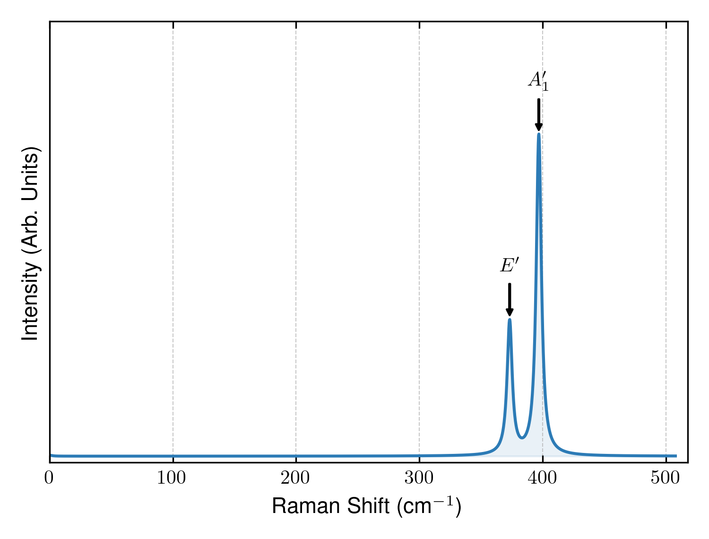

# Tutorial: Monolayer MoS₂ Raman Spectrum

This directory is a small SpectroPy example for monolayer MoS₂. It includes a
relaxed structure, Gamma-point Phonopy bands, and a precomputed
frequency-dependent dielectric-derivative file at 1.96 eV. You can therefore
run the spectrum and plotting stages without VASP.

The example is useful for checking your installation and for seeing the
expected file and command conventions. It is not a substitute for converging a
new calculation's DFT and phonon settings.

## Prerequisites

Install SpectroPy from the repository root:

```bash
python -m pip install .
```

For plotting, install the optional plotting dependency:

```bash
python -m pip install '.[plot]'
```

Return to this tutorial directory before running the commands below:

```bash
cd examples/MoS2_Tutorial
```

## Included files

- `CONTCAR`, `INCAR`, and `KPOINTS`: VASP structure and example input files.
  The shared tutorial uses `ISYM = -1` for displaced-cell optical calculations
  to avoid imposed symmetry in the off-diagonal dielectric response.
- `band.yaml`: Gamma-point phonon modes from Phonopy.
- `dielectric_derivatives_1.96`: precomputed SpectroPy dielectric derivatives
  at a 1.96 eV laser energy, retained under its historical filename.
- `input.yaml`: non-interactive geometry, laser-energy, displacement, polarization,
  and broadening settings used by the tutorial.
- `Raman_plot_styled.png`: a reference image from the earlier workflow.

The current command-line workflow names derivative files
`epsilon_derivative_<energy>`. The quick start below makes a working copy of
the bundled historical file; it does not alter the reference file.

## Quick start: spectrum from the bundled data

```bash
cp dielectric_derivatives_1.96 epsilon_derivative_1.96
spectropy spectrum
spectropy plot
```

`input.yaml` selects a 1.96 eV laser, parallel in-plane incident/scattered
polarizations, polarization averaging, and a 1.0 cm⁻¹ Lorentzian FWHM
(0.5 cm⁻¹ HWHM in this historical example). The
commands create:

- `Raman_tensor`
- `Raman_intensity_complex_1.96eV`
- `Raman_intensity_polarization_averaged_1.96eV`
- `Raman_intensity_complex_broadening_1.96eV`
- `Raman_plot_styled_Raman_intensity_complex_1.96eV.png`
- `Raman_plot_styled_Raman_intensity_polarization_averaged_1.96eV.png`

The broadened numerical file is two columns: Raman shift in cm⁻¹ and
unnormalized broadened intensity. The PNG is normalized for display.



## Understanding `input.yaml`

The geometry and calculation settings are all named entries:

```yaml
incident_polarization: [1, 0, 0]
scattered_polarization: [1, 0, 0]
surface_normal: z
laser_energies: [1.96] # eV
displacement_amplitude: 0.03 # Angstrom
symmetry: off
displacement_basis: cartesian
polarization: average # write summed polarization-channel intensity too
broadening_hwhm: 0.5 # cm-1, half width at half maximum
broadening_type: lorentzian
```

`laser_energies` may contain multiple values in a YAML list. Omitting it
uses `0.00 eV`, the static-limit case. `displacement_amplitude` defaults to
0.03 Å in all three modes. The supplied `broadening_hwhm: 0.5` preserves the
reference spectrum's 1.0 cm⁻¹ full width.

## Full calculation workflow

Use these steps for a new material, after preparing a relaxed `CONTCAR` and a
Gamma-point Phonopy calculation.

### 1. Create a Phonopy symmetry file

The `atoms` and `on` derivative stages require Phonopy's YAML symmetry output:

```bash
phonopy --symmetry -c CONTCAR > symmetry
```

### 2. Generate displaced structures

Choose the displacement strategy and basis in `input.yaml`:

```yaml
symmetry: off # on, off, or atoms
displacement_basis: cartesian # cartesian or fractional
```

`off` displaces every atom along three axes; `atoms` keeps atomic
representatives; `on` also reduces directions by site symmetry. Then run:

```bash
spectropy displacements
```

Every mode writes `atomic_displacement`, `displacements.dat`,
`displacements/pos_atom*`, and `displacements/ra_pos_atom*/POSCAR`.
Use `displacement_basis: fractional` with any mode to select fractional candidates.

Place your optical `INCAR`, `KPOINTS`, and `POTCAR` in the working directory
before generation. SpectroPy symlinks supplied files into each displaced
directory, warns about missing inputs, and refuses to replace
conflicting inputs. It does not choose their contents, submit jobs, or run VASP.

### 3. Evaluate dielectric derivatives

Each completed VASP directory must contain `vasprun.xml` with dielectric data.
Then run:

```bash
spectropy derivatives
```

For every value in `laser_energies`, this writes:

- `dielectric_tensor_<energy>`: the dielectric tensor data from every
  displacement.
- `epsilon_derivative_<energy>`: the assembled complex dielectric derivatives
  used by the spectrum stage.
- `raw_directional_derivative_<energy>.json`: raw measured-direction responses.

Denoising is optional via `site_symmetry_projection: true`; see the
[advanced documentation](../../docs.md#symmetry-denoising-and-raman-tensors).

### 4. Calculate and plot the spectrum

```bash
spectropy spectrum
spectropy plot
```

Use `spectropy --help` or `spectropy displacements --help` to see the current
CLI options.
