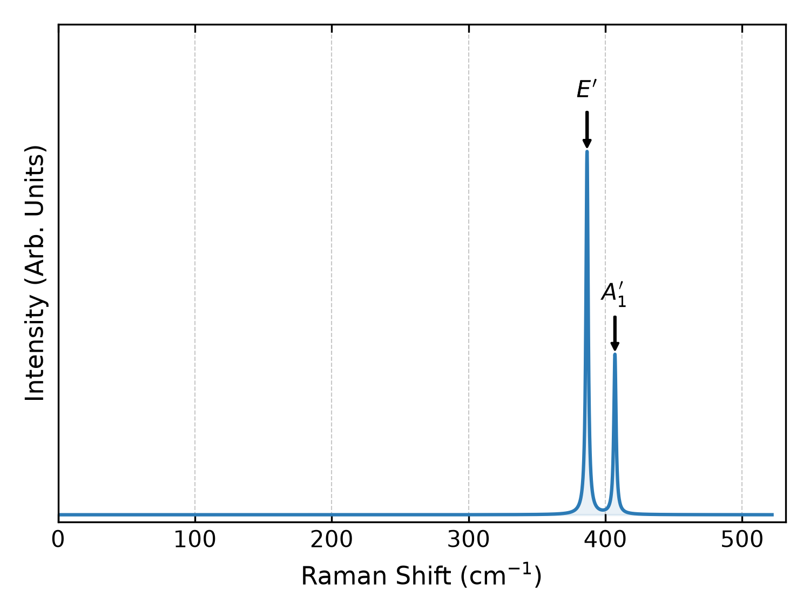

# MoS₂: VASP

This example reduces **nine atomic displacement directions to two** using
symmetry—a **78% reduction in sampled directions** for this three-atom MoS₂
cell. SpectroPy reconstructs the remaining directions and equivalent atoms,
denoises the atomic responses, and calculates the mode Raman tensors.
The savings depend on the structure's retained symmetry, not just its size.

The **minimal Cartesian, 0.01 Å PBEsol benchmark** includes the calculated
structures, phonons, and complete dielectric XML outputs. You can analyze
these immediately **without running VASP**, or generate your own outputs below.

## Analyze the supplied VASP outputs

From the repository root:

```bash
python -m pip install '.[all]'
cd examples/MoS2_vasp
spectropy tensors
spectropy spectrum
spectropy plot
```

| Command | Output at 0.00 eV |
| --- | --- |
| `tensors` | `Raman_tensor_0.00eV`: final complex Cartesian mode tensors, plus the atomic and dielectric outputs below. |
| `spectrum` | `Raman_intensity_complex_0.00eV` for xx polarization; `Raman_intensity_polarization_averaged_0.00eV` for the in-plane channel sum. |
| `plot` | PNG spectra and the unnormalized two-column broadened xx spectrum. |

`input.yaml` selects central differences, symmetry reduction and denoising,
and Lorentzian HWHM 1 cm⁻¹. `spectrum.cutoff: 0` retains the benchmark's
Bose/phonon-frequency factor for positive-frequency modes. This tutorial also
enables the optional atomic and dielectric exports:

```yaml
output:
  per_atom:
    enabled: true
    raw_directional_derivatives: true
```

| Additional `spectropy tensors` output | Contents |
| --- | --- |
| `raw_directional_derivative_0.00` | Labeled text: raw real/imaginary per-atom derivative matrices along the measured unit directions, including step lengths and whether symmetry supplied the opposite sign. |
| `epsilon_derivative_0.00` | Final **denoised and reconstructed** atomic derivatives: real/imaginary Cartesian x, y, z slices for every atom. |
| `dielectric_tensor_0.00` | Sampled, unprojected real/imaginary Cartesian dielectric matrices for each directly calculated signed displacement. |

Atomic derivative exports include $V_{\rm cell}/(4\pi)$ and have units of Ų;
the sampled dielectric matrices are dimensionless and have no volume factor.
The raw derivatives retain the **measured mixed-direction basis**, not inferred
Cartesian slices or equivalent atoms. All nine dielectric components are retained
independently in this example. These exports are enabled here for inspection;
the library default still saves only the final mode tensors.
See [Advanced Usage](../../docs.md) for formats and optional settings.

### Static spectrum



The prominent peaks are the in-plane $E'$ and out-of-plane $A_1'$ modes.
This is the **static dielectric-response limit**, not a zero-energy scattering
experiment. The plot is normalized for display; numerical spectra are not.

### Scan many laser energies

Instead of typing a long list, replace the energy selection with an inclusive
range:

```yaml
spectrum:
  energies: {start: 0.0, stop: 4.0, step: 0.1}
  cutoff: 0
```

This selects 41 energies. Rerun `spectropy tensors`, `spectropy spectrum`, and
`spectropy plot`. No new VASP runs are needed when the supplied XML grids cover
the requested energies. For isolated energies, a list still works:
`energies: [0.00, 1.96, 2.33]`.

## Generate your own VASP outputs

Start in a **new directory** so the bundled results remain unchanged.
From the repository root:

```bash
mkdir MoS2_new
cp examples/MoS2_vasp/{CONTCAR,INCAR,KPOINTS,band.yaml,irreps.yaml,symmetry,input.yaml} MoS2_new/
cd MoS2_new
# Supply your own licensed POTCAR: Mo_pv, then S.
spectropy displacements
```

SpectroPy generates the displaced POSCARs and symlinks supplied `INCAR`,
`KPOINTS`, and `POTCAR` into each calculation directory. Run VASP through your
own local or cluster launcher in **every generated** `displacements/ra_pos_atom*/`
directory. These are optical single-point calculations: keep `NSW=0` and do
not relax the displacements.

To match this example, use PAW_PBE Mo_pv 04Feb2005 followed by S 06Sep2000
when assembling your `POTCAR`.

Check electronic convergence, successful completion, and the dielectric data
in each `vasprun.xml`; a parseable XML file alone does not prove convergence.
Then run the same three analysis commands above. Licensed `POTCAR` files,
VASP executables, and cluster submission scripts are not distributed.

## Compare symmetry on and off

To repeat the full-versus-minimal benchmark, make two fresh working directories
as above, with identical geometry, phonons, VASP binary, potentials, optical
settings, displacement length, and Cartesian candidate basis. **Before generating
displacements**, change only `symmetry.reduction` between the two inputs:

| Setting | Minimal run | Full Cartesian run |
| --- | --- | --- |
| `symmetry.reduction` | `on` | `off` |
| `symmetry.denoise` | `true` | `true` |
| Sampled atomic directions | 2 mixed directions, on representative Mo and S atoms | 9 axes: x, y, z for each of the 3 atoms |
| `displacements.amplitude` | 0.01 Å | 0.01 Å |
| `displacements.difference` | `central` | `central` |

Run `spectropy displacements`, VASP, and the analysis commands separately in
each directory. The bundled minimal data contain three signed structures:
one Mo sign (its opposite is symmetry-generated) and both S signs. The full
run requires its **own** electronic outputs; do not relabel or copy minimal
responses into full-displacement folders.

Compare the final `Raman_tensor_0.00eV` elements and spectra on a **common
intensity scale**. Keeping the same `band.yaml` removes eigenvector-basis and
phase differences from this test. The tutorial's output settings also save raw
directional derivatives, final Cartesian atomic derivatives, and sampled
dielectric matrices in both runs.

Reduction and denoising are separate controls. Keep denoising equal in both
runs to test displacement reduction; set it to `false` in both for an
unprojected control. The minimal raw responses are along **mixed directions**,
not directly measured x/y/z slices: compare them with the full field contracted
onto those same directions, not with individual Cartesian entries.

Exact numerical equality is not guaranteed at finite displacement. Differences
can expose electronic noise or finite-step error; denoising cannot remove
symmetry-allowed errors. The full benchmark XMLs are not bundled here, so this
section describes how to run the comparison rather than asserting agreement.
