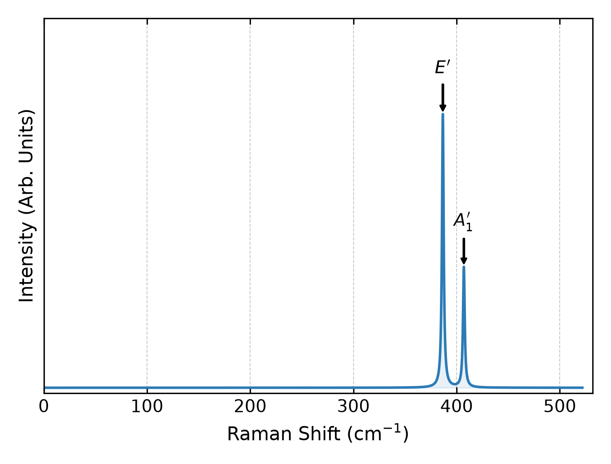

# MoS₂: VASP

This tutorial provides a relaxed **1×1 monolayer MoS₂ cell** containing one Mo
and two S atoms, together with calculated phonons and VASP dielectric responses,
to compute Raman tensors and an **xx-polarized Raman spectrum** using SpectroPy.

Monolayer MoS₂ consists of a molybdenum layer between two sulfur layers and has
$D_{3h}$ symmetry. Its three-atom cell has nine vibrational modes at Gamma.
Before considering polarization, **five optical modes are Raman-active**:
the two partners of $E''$, the two partners of $E'$, and the single $A_1'$ mode.
In the xx geometry used here, the $E'$ and $A_1'$ modes contribute to the spectrum.

Calculating all five Raman-active modes with central differences would require
**10 displaced structures**, one positive and one negative displacement per mode.
SpectroPy instead uses atomic displacements and crystal symmetry to generate
**only 3 displaced structures—a 70% reduction**: one Mo displacement and a
positive/negative pair for one S atom. Symmetry supplies the opposite Mo response
and the remaining atomic derivatives. SpectroPy then denoises the derivatives
and combines them with the phonon eigenvectors to obtain the Raman tensors.

The tutorial includes the relaxed structure, phonon files, SpectroPy settings,
VASP input templates, and completed dielectric outputs. You can calculate the
tensors and spectrum immediately **without running VASP**, or follow the later
sections to generate your own outputs and compare symmetry reduction on and off.


## Analyze the supplied VASP outputs

From the repository root:

```bash
python -m pip install '.[all]'
cd examples/MoS2_vasp
spectropy tensors
spectropy spectrum
spectropy plot
```

See the [main workflow guide](../../README.md#step-4-calculate-raman-tensors)
for more detailed descriptions of the commands and generated files.


### Static spectrum



The prominent peaks are the in-plane $E'$ and out-of-plane $A_1'$ modes.
This is the **static dielectric-response limit**.
The plot is normalized for display, while numerical spectra are not.

### Scan many laser energies

To scan a range of laser energies, replace the energy selection with an inclusive
range:

```yaml
spectrum:
  energies: {start: 0.0, stop: 4.0, step: 0.1}
  cutoff: 0
  temperature: 298
```

This selects 41 energies. Rerun `spectropy tensors`, `spectropy spectrum`, and
`spectropy plot`. No new VASP runs are needed when the supplied XML grids cover
the requested energies. For isolated energies, a list still works:
`energies: [0.00, 1.96, 2.33]`.

## Generate your own VASP outputs

Start in a **new directory** so the bundled results remain unchanged.
From the repository root:

```bash
mkdir MoS2_new
cp examples/MoS2_vasp/{CONTCAR,INCAR,KPOINTS,band.yaml,irreps.yaml,symmetry,input.yaml} MoS2_new/
cd MoS2_new
# Supply your own licensed POTCAR: Mo_pv, then S.
spectropy displacements
```

This reuses the bundled geometry and phonons. If you change or re-relax the
structure, follow the [Phonopy export instructions](../../README.md#export-the-files-from-an-existing-phonon-calculation)
instead of copying the old phonon files.

SpectroPy generates the displaced POSCARs and symlinks supplied `INCAR`,
`KPOINTS`, and `POTCAR` into each calculation directory. Run VASP through your
own local or cluster launcher in **every generated** `displacements/ra_pos_atom*/`
directory.

Suggestions for displaced optical calculations:

- **Disable VASP symmetry:** use `ISYM=-1`. SpectroPy handles displacement
  reduction and reconstruction separately. See [VASP's symmetry settings](https://vasp.at/wiki/ISYM).
- **Start each calculation fresh:** set `ISTART=0` and `ICHARG=2` so VASP does
  not read `WAVECAR` or `CHGCAR`. `LWAVE` and `LCHARG` only control writing
  those files, not reading them. See [ISTART](https://vasp.at/wiki/ISTART)
  and [ICHARG](https://vasp.at/wiki/ICHARG).
- **Calculate the optical response:** use `LOPTICS=.TRUE.` and enough empty
  bands (`NBANDS`) to converge the dielectric response over your energy range.
  The supplied input uses `NBANDS=64`; this is a starting point for this cell,
  not a universal value. See [VASP's optical-calculation guidance](https://vasp.at/wiki/LOPTICS).
- **Keep the displacements fixed:** use `NSW=0`; do not relax the displaced structures.
- **Control numerical noise:** keep the same potentials, k-point mesh, cutoff,
  smearing, and optical settings for every displacement. Use tight electronic
  convergence (the supplied input uses `EDIFF=1E-08`) and check convergence
  with respect to k-points, `ENCUT`, and `NBANDS`.

To match this example, use PAW_PBE Mo_pv 04Feb2005 followed by S 06Sep2000
when assembling your `POTCAR`.

Check electronic convergence, successful completion, and the dielectric data
in each `vasprun.xml`, then follow the Spectropy commands above.

## Compare symmetry on and off

Comparing the results with symmetry enabled and disabled is useful for determining
the sources of numerical noise present in the VASP outputs. 

For this comparison, make two fresh working directories
as above, with identical geometry, phonons, VASP binary, potentials, optical
settings, displacement length, and Cartesian candidate basis. **Before generating
displacements**, change only `symmetry.reduction` between the two inputs:

| Setting | Minimal run | Full Cartesian run |
| --- | --- | --- |
| `symmetry.reduction` | `on` | `off` |
| `symmetry.denoise` | `true` | `true` |
| `displacements.amplitude` | 0.01 Å | 0.01 Å |
| `displacements.difference` | `central` | `central` |

Run `spectropy displacements`, VASP, and the analysis commands separately in
each directory. The bundled minimal data contain three signed structures:
one Mo sign (its opposite is symmetry-generated) and both S signs. The full
run will require its **own** electronic outputs.

Compare the final `Raman_tensor_0.00eV` elements and spectra on a **common
intensity scale**. 

